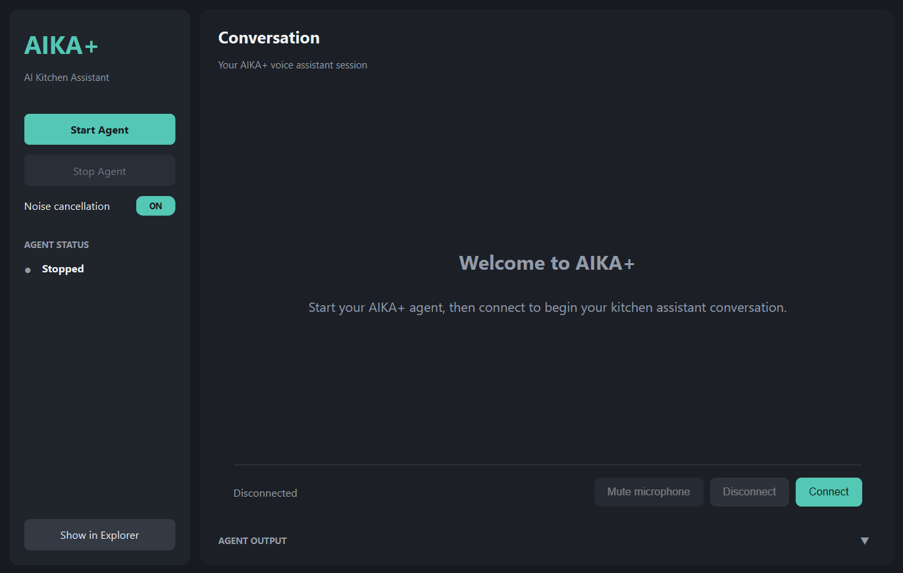
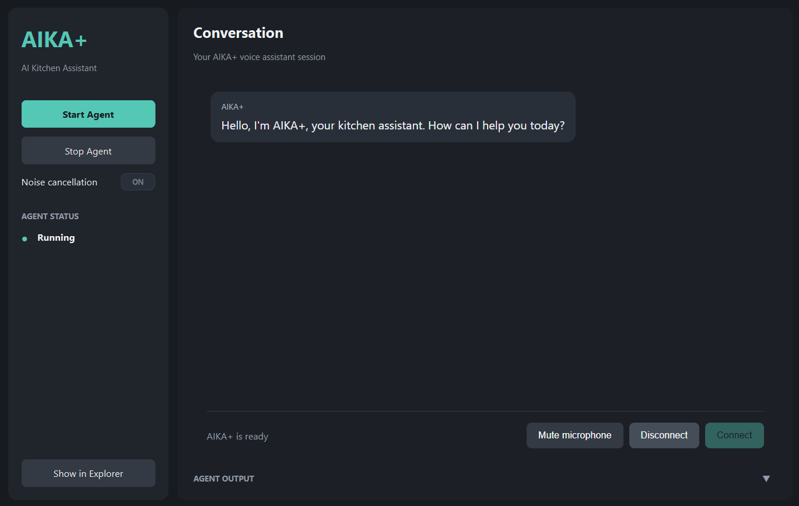
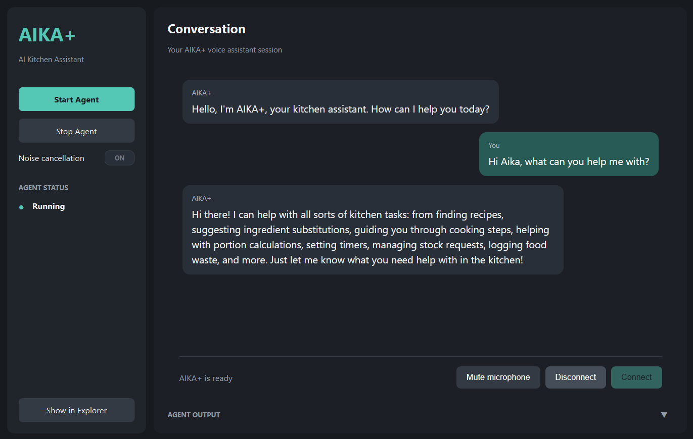
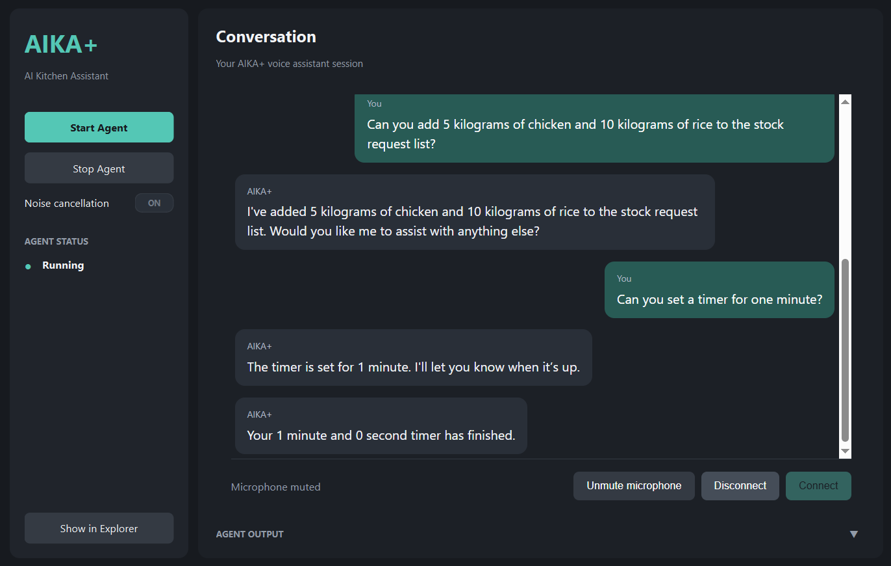
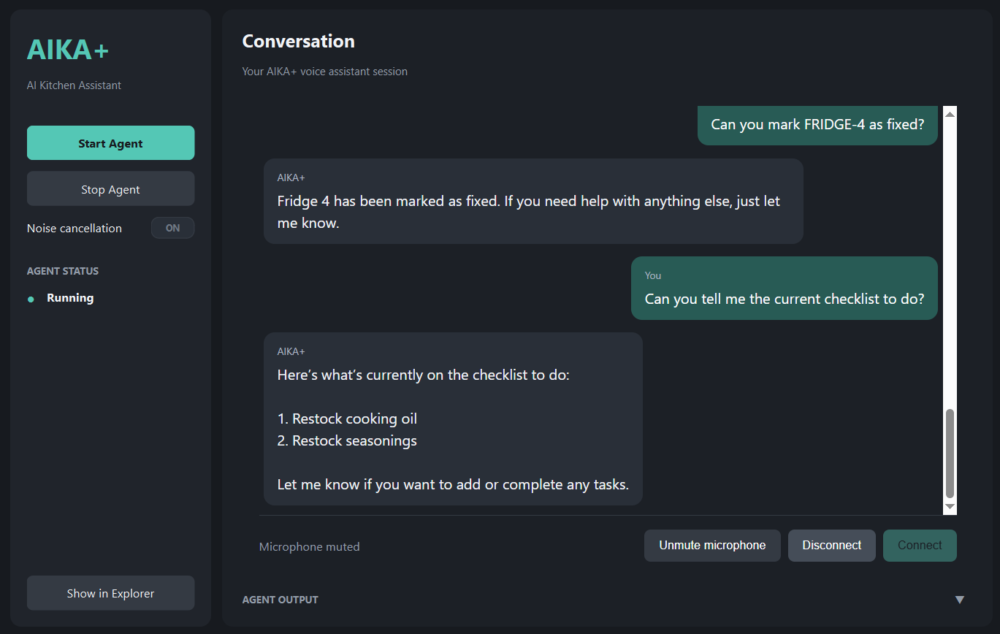
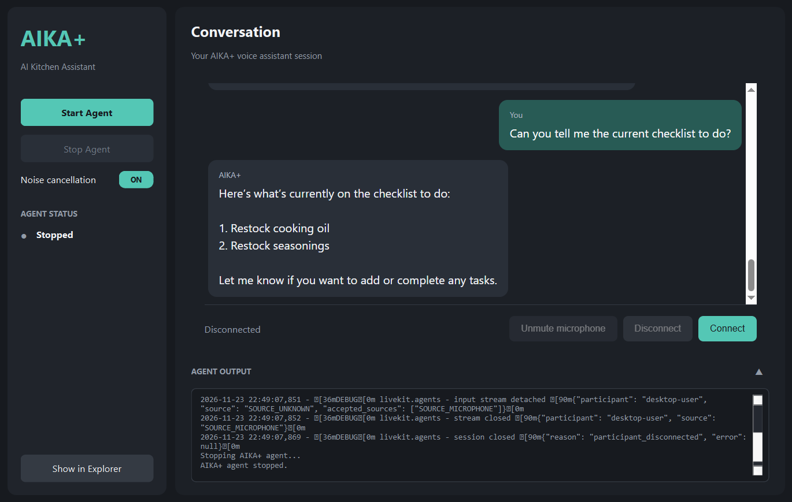
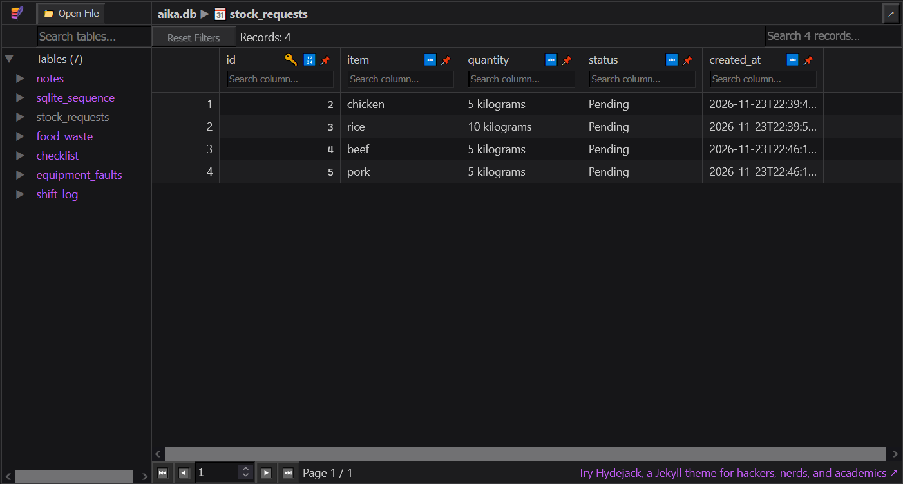
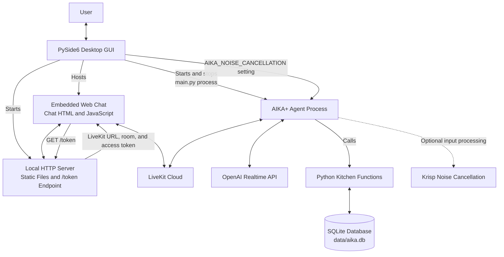

# AIKA+ Voice Assistant

AIKA+ (AI Kitchen Assistant) is a voice controlled kitchen assistant designed to provide hands free support in a kitchen environment.

Built using Python, AIKA+ uses an AI voice agent to understand spoken requests and assist with everyday kitchen tasks. It connects to LiveKit Cloud for real time voice communication and uses the OpenAI Realtime API to process conversations and generate responses.

The application features a desktop interface built with PySide6.

## Features and Functions

AIKA+ includes a range of features designed to assist with everyday kitchen operations.

1. **Timers and Reminders**
   - Set timers and reminders using voice commands.
   - Receive notifications when a timer or reminder expires.

2. **Kitchen Notes**
   - Add, view and remove saved kitchen notes.
   - Store notes in a local SQLite database.

3. **Stock Requests**
   - Add stock requests with item names and quantities.
   - View and remove existing requests.
   - Mark stock requests as ordered.

4. **Recipe Assistance**
   - Request recipes using voice commands.
   - Receive ingredient lists and step by step preparation instructions.

5. **Food Waste Tracking**
   - Record wasted food, quantities, dates and additional details.
   - Retrieve food waste records for a specific date.

6. **Portion Calculator**
   - Calculate ingredient quantities for different serving sizes.
   - Adjust ingredient amounts based on the required number of portions.

7. **Chef Identification**
   - Record the chef starting a shift.
   - Ask to identify the currently recorded chef.

8. **Kitchen Checklist**
   - Add, view, complete and remove kitchen tasks.
   - Filter tasks by category and completion status.

9. **Ingredient Substitutions**
   - Request alternative ingredients when something is unavailable.
   - Receive practical substitution suggestions and information about possible differences.

10. **Equipment Fault Reporting**
    - Record reported equipment faults.
    - View existing faults.
    - Mark equipment faults as resolved.

## Example Voice Commands

Users can interact with AIKA+ naturally using spoken requests. Some examples include:

- "AIKA, can you add 5 kilograms of chicken to the stock request list?"
- "AIKA, can you set a timer for 5 minutes?"
- "AIKA, can you add restock cooking oil to the to do list?"
- "AIKA, can you mark fridge 4 as fixed?"
- "AIKA, can you tell me the current to do list?"

## Application Screenshots

The following screenshots demonstrate the AIKA+ desktop interface and its main features.













## Project Structure

The project is organised into the following directories and files:

```text
aika-voice-assistant/
│
├── src/
│   ├── functions.py
│   ├── gui.py
│   ├── main.py
│   ├── token_server.py
│   │
│   └── web/
│       ├── chat.html
│       └── chat.js
│
├── data/
│   └── aika.db
│
└── .env
```

### Main Files

| File | Description |
|---|---|
| `src/main.py` | Contains the AIKA+ voice agent, its instructions, LiveKit configuration and available assistant functions. |
| `src/gui.py` | Creates the desktop application using PySide6. Handles the application interface, agent controls and process management. |
| `src/functions.py` | Contains the kitchen management functions and SQLite database operations. |
| `src/token_server.py` | Runs the local server that generates temporary access tokens for connecting the chat interface to LiveKit. |
| `src/web/chat.html` | Defines the embedded web based conversation interface and its layout. |
| `src/web/chat.js` | Handles LiveKit connection, microphone controls, audio playback and conversation transcripts. |
| `data/aika.db` | Local SQLite database used to store kitchen management records. |
| `.env` | Stores the API credentials and connection details required by the application. |

The `.env` file requires the following environment variables:

```env
LIVEKIT_URL=
LIVEKIT_API_KEY=
LIVEKIT_API_SECRET=
OPENAI_API_KEY=
```

**Note:** The `.env` file contains private credentials.

## Noise Cancellation

AIKA+ includes an optional Krisp Noise Cancellation setting that can be enabled or disabled through a toggle switch in the desktop interface.

This feature is intended to help reduce background noise in busy kitchen environments, making it easier for the voice assistant to understand spoken commands.

Users can choose whether to enable noise cancellation depending on their environment and requirements.

## Database and Data Storage

AIKA+ uses SQLite for local data storage. The database is located in `data/aika.db` and is used to store kitchen management information, including:

- Kitchen notes
- Stock requests
- Food waste records
- Kitchen checklist tasks
- Equipment faults
- Chef shift information

This allows records to remain available between application sessions without requiring a separate database server.

Timers and reminders are handled while the AIKA+ agent is running. Pending timers and reminders are not retained if the agent process is stopped.



## System Architecture

AIKA+ uses a combination of local application components and cloud based services to provide real time voice interaction.

The desktop application manages the user interface and starts the voice agent. A local token server generates temporary access tokens for the embedded web chat interface, which connects to LiveKit Cloud.

LiveKit Cloud provides the real time communication layer between the user's microphone, the AIKA+ agent and the web based conversation interface. The agent uses the OpenAI Realtime API to understand and respond to spoken requests.

When a user requests a kitchen management action, the agent can call the appropriate Python function in `functions.py`. These functions interact with the local SQLite database when stored information needs to be added, retrieved or updated.

### Architecture Diagram



### Main Components

| Component | Purpose |
|---|---|
| PySide6 | Provides the desktop interface and manages the AIKA+ agent process. |
| Local Token Server | Generates temporary access tokens for the web chat connection. |
| LiveKit Cloud | Handles real time audio communication between the user and AIKA+ agent. |
| OpenAI Realtime API | Processes spoken input and generates AI responses. |
| Python Kitchen Functions | Performs kitchen management operations requested by the user. |
| SQLite | Stores kitchen management records locally. |
| Krisp Noise Cancellation | Provides optional background noise reduction for voice communication. |

## Setup and Usage

### Requirements

- Python 3.12 or later
- A LiveKit Cloud account
- An OpenAI API key
- Git

### Installation

1. Clone the repository (to a folder of your choice):

   ```bash
   git clone https://github.com/username/repo-name.git
   cd aika-voice-assistant
   ```

   Replace the placeholders with GitHub username and repository name.

2. Create a Python virtual environment:

   ```bash
   python -m venv .venv
   ```

3. Activate the virtual environment.

   **Windows:**
   ```powershell
   .venv\Scripts\activate
   ```

   **Linux/Mac:**
   ```bash
   source .venv/bin/activate
   ```

4. Install the required dependencies:

   ```bash
   pip install -r requirements.txt
   ```

### Environment Configuration

Create a `.env` file in the project root directory and add the following credentials:

```env
LIVEKIT_URL=your_livekit_url
LIVEKIT_API_KEY=your_livekit_api_key
LIVEKIT_API_SECRET=your_livekit_api_secret
OPENAI_API_KEY=your_openai_api_key
```

Replace the placeholder values with your actual credentials.

### Running AIKA+

Start the desktop application from the project root directory:

```bash
python src/gui.py
```

### Using the Assistant

1. Launch AIKA+.
2. Start the assistant using the Start Agent button.
3. Connect to the assistant using the Connect button.
4. Allow microphone access when prompted.
5. Speak naturally to request kitchen assistance.
6. Use the Disconnect and Stop Agent buttons when finished.